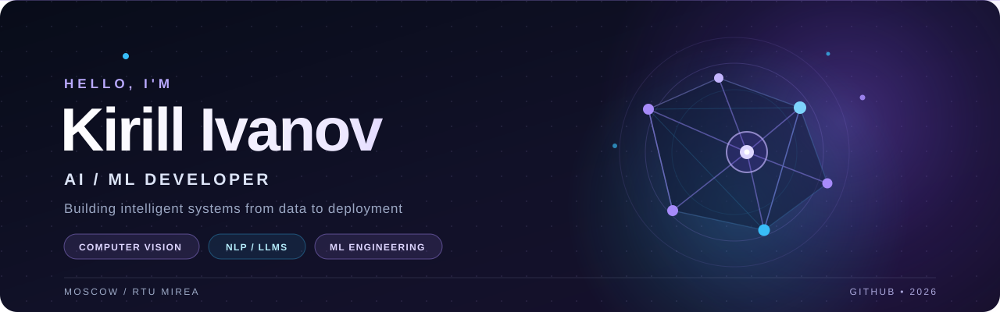

<!--
  KIRILL IVANOV — GITHUB PROFILE
  Theme: ultraviolet / midnight
  The banner lives in assets/hero.svg. Keep that file in the same repository.
  Project results are based on the achievements supplied by the profile owner.
-->

  

   

  

    
    
    
    
  

  

    <b>Machine Learning</b> &nbsp;·&nbsp; <b>Computer Vision</b> &nbsp;·&nbsp; <b>NLP &amp; LLMs</b> &nbsp;·&nbsp; <b>AI Agents</b>
  

  

    📍 Moscow, Russia &nbsp;&nbsp;|&nbsp;&nbsp; 🎓 RTU MIREA &nbsp;&nbsp;|&nbsp;&nbsp; 🌐 Russian (Native) · English (C2)
  

## About

I develop **practical AI and data-driven systems**, focusing on computer vision, machine learning, natural language processing, and engineering workflows for AI agents. My work spans the full pipeline: **data preparation → modeling → evaluation → optimization → integration**.

I enjoy turning complex problems into measurable improvements — faster inference and data processing, stronger model quality, and more reliable developer tooling.

## Impact at a glance

<table>
  <tr>
    <td align="center" width="25%"><strong>TOP 6</strong> ArenaData · NER</td>
    <td align="center" width="25%"><strong>TOP 13 / 350</strong> X5 Growth Gradient R1</td>
    <td align="center" width="25%"><strong>1ST PLACE</strong> International English Essay Contest</td>
    <td align="center" width="25%"><strong>1000+ DOWNLOADS</strong> Dataset · Kaggle + Hugging Face</td>
  </tr>
</table>

## Featured projects

<table>
  <tr>
    <td width="50%" valign="top">
      <h3>🔗 GitHub AI MCP</h3>
      

      
A security-focused GitHub MCP integration for AI agents: repository operations, task branches, code review, and pull-request workflows.

      
<code>Python</code> <code>MCP</code> <code>Git</code> <code>GitHub API</code> <code>SQLite</code>

      2026 — Present
    </td>
    <td width="50%" valign="top">
      <h3>🔎 SherlockPC</h3>
      

      
A local AI assistant for system monitoring, behavioral analysis, and diagnostics, built around actionable on-device signals.

      
<code>Python</code> <code>psutil</code> <code>SQLite</code> <code>OpenCV</code> <code>OCR</code>

      2026 — Present
    </td>
  </tr>
</table>

> **Engineering interests:** trustworthy agent tooling, efficient vision pipelines, applied NLP, and end-to-end ML systems.

## Achievements

A selection of competition results, engineering outcomes, and their **original supporting documents** — collected in one place.

| Competition / Project | Highlights | Evidence |
| :--- | :--- | :--- |
| 🏆 **IV International English Essay Contest**  2025 · English-language essay on social media and digital addiction | **1st place · 1st Degree Diploma** | [📄 View diploma](./achievements/diploma-KGEU-1st-degree-2025.pdf) |
| 🧠 **ArenaData**  2026 · Named entity recognition | **Top 6** · Precision **0.94** · Recall **0.91** · **4.3× faster** | [📄 Certificate](./achievements/ARENADATA_certificate.pdf) |
| 📈 **X5 Growth Gradient**  2026 · Time-series forecasting | **Round 1: Top 13 / 350**, RMSE **0.093**   **Round 2: Top 23 / 300** | [📄 R1 results](./achievements/%D0%A0%D0%B5%D0%B7%D1%83%D0%BB%D1%8C%D1%82%D0%B0%D1%82%D1%8B%201%20%D1%8D%D1%82%D0%B0%D0%BF%D0%B0%20%D0%93%D1%80%D0%B0%D0%B4%D0%B8%D0%B5%D0%BD%D1%82%20%D1%80%D0%BE%D1%81%D1%82%D0%B0.pdf) · [📄 R2 results](./achievements/%D0%A0%D0%B5%D0%B7%D1%83%D0%BB%D1%8C%D1%82%D0%B0%D1%82%D1%8B%202%20%D1%8D%D1%82%D0%B0%D0%BF%D0%B0%20%D0%93%D1%80%D0%B0%D0%B4%D0%B8%D0%B5%D0%BD%D1%82%D0%B0%20%D1%80%D0%BE%D1%81%D1%82%D0%B0.pdf) |
| ⚙️ **MTS True Tech Hack**  2026 · ML validation and architecture | **Finalist / Top 15** · F1 **0.68 → 0.84** · Manual review **−40%** | [📄 Certificate](./achievements/certificate-МТС-True-Tech-Hack-2026.pdf) |
| 👁️ **IT Academy Hackathon — Find Yourself in Big Data**  2026 · Video OCR and parallel processing | Recall **67% → 89%** · Runtime **15 → 6 min** | [📄 Participation certificate](./achievements/%D0%A5%D0%B0%D0%BA%D0%B0%D1%82%D0%BE%D0%BD_%D0%98%D0%A2_%D0%90%D0%BA%D0%B0%D0%B4%D0%B5%D0%BC%D0%B8%D0%B8_2026_%D0%A1%D0%B5%D1%80%D1%82%D0%B8%D1%84%D0%B8%D0%BA%D0%B0%D1%82_%D1%83%D1%87%D0%B0%D1%81%D1%82%D0%BD%D0%B8%D0%BA%D0%B0_%D0%A5%D0%B0%D0%BA%D0%B0%D1%82%D0%BE%D0%BD%D0%B0_%D0%98%D0%A2_%D0%90%D0%BA%D0%B0%D0%B4%D0%B5%D0%BC%D0%B8%D0%B8.pdf) |

  
  
Competition documentation and certificates are stored as PDFs in this repository. Engineering metrics reflect reported project results.

## Open datasets

<table>
  <tr>
    <td valign="top" width="70%">
      <h3>📦 <a>SherlockBench — Windows Workload Telemetry</a></h3>
      
My dataset has reached <b>1000+ combined downloads</b> across <b>Kaggle</b> and <b>Hugging Face</b>. Explore the dataset directly on either platform.

      
<a href="https://www.kaggle.com/datasets/fireaideveloper/sherlockbench-windows-workload-telemetry">View on Kaggle ↗</a> &nbsp;·&nbsp; <a href="https://huggingface.co/datasets/fireaideveloper/SherlockBench">View on Hugging Face ↗</a>

    </td>
    <td align="center" valign="middle" width="30%">
      <strong>1000+ DOWNLOADS</strong> 
      Combined across both platforms
    </td>
  </tr>
</table>

  

## Currently exploring

- **Agentic development:** secure MCP tooling, repo automation, and developer-assistance workflows.
- **Applied AI:** computer vision, OCR, document intelligence, and hybrid NLP systems.
- **Model efficiency:** profiling, quantization, reproducible experiments, and reliable evaluation.

---

  
<b>Build useful things. Measure what matters. Keep improving.</b>

  

    
    
    
  

  

    
  

  © 2026 Kirill Ivanov · Moscow · RTU MIREA

